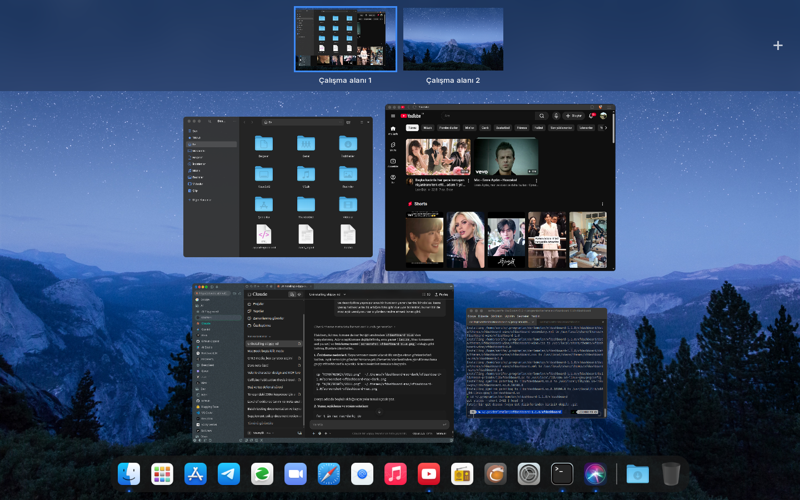

# xfdashboard-mac

A macOS-like Mission Control for Xfce: xfdashboard 1.1.0 with patches, plus two themes (light and dark) and a dock that looks and behaves like [Plank](https://github.com/zquestz/plank-reloaded). Built and used daily on a MacBook Air (mid 2012) running Xubuntu 24.04.



Based on [xfdashboard](https://gitlab.xfce.org/apps/xfdashboard) by Stephan Haller ([gmc-holle](https://github.com/gmc-holle/xfdashboard)), maintained by the Xfce project. This repository is a fork of its GitHub mirror; the first commits are upstream's history up to the `xfdashboard-1.1.0` tag, and everything on top is this fork.

## What's different

### Mission Control layout (themes)

- Workspaces as a strip along the top, names under the thumbnails, the current one outlined in blue; a **+** in the top right corner adds a workspace.
- Windows fill the rest of the screen with large previews: rounded corners, a blue outline and the title only under the pointer, a round close button on hover.
- Minimized windows and windows on other workspaces keep showing their last picture instead of an icon.
- "No Available Windows" in the middle when there is nothing to show.
- The search box is invisible until you start typing; results look like Spotlight (small icon, name, one line of description).
- Applications view as a Launchpad-like grid: 7 columns, single-line names, blurred wallpaper behind.

### Plank-like dock

Only in themes that opt in with `plank-style: true;` (both mac themes do). Other xfdashboard themes keep the stock dock.

- Running indicators copied pixel by pixel from Plank: a small blue dot with a soft glow at the bottom edge.
- A light band behind the applications button while the applications view is open, like Plank's active item.
- Plank's separators become dividers; the applications button can sit anywhere in the dock (e.g. right of Finder); folders and Trash stay at the end.
- Hover zoom like Plank (`hover-zoom` in the theme): icons grow above the dock, the dock keeps its height, neighbours grow a little.
- App names in a rounded box above the icon.

`mac/plank-to-xfdashboard.py` copies Plank's items (in order, with separators, folders and Trash) to xfdashboard's dock. Run it again after changing Plank.

## Install

```sh
git clone https://github.com/memecikoliveoil/xfdashboard-mac.git
cd xfdashboard-mac
meson setup build --prefix=/usr/local
ninja -C build && sudo ninja -C build install

sh mac/xfdashboard-mac-kur.sh            # installs ~/.themes/xfdashboard-mac and -dark
python3 mac/plank-to-xfdashboard.py      # optional: dock items from Plank

xfdashboard -q; xfdashboard -d &         # run as daemon
```

The themes are built from the stock `xfdashboard-blue` theme, so that one must be installed (it is, with the steps above).

Previews of other workspaces need xfdashboard running as a daemon (`-d`): it keeps the last picture of each window while it is shown.

The mac themes use background images in `~/.config/xfdashboard/` (`background.png`, `workspace-background.png`, `launchpad-background.png`). I generate them from the current wallpaper with my own theme switcher (blurred band behind the workspaces, blurred and darkened wallpaper behind the applications view).

## License

GPL-2.0-or-later, like xfdashboard.
